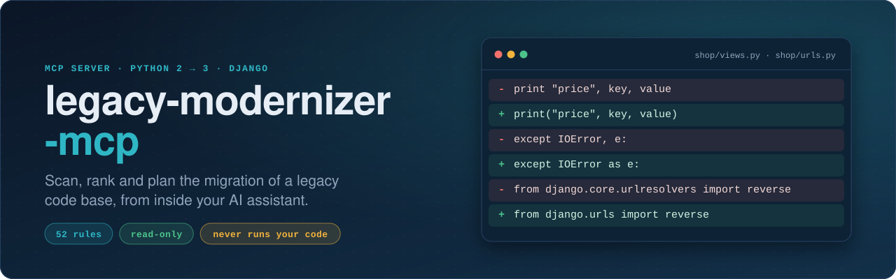
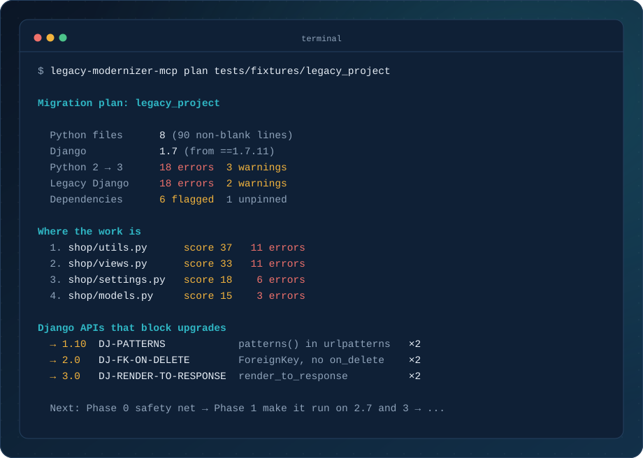
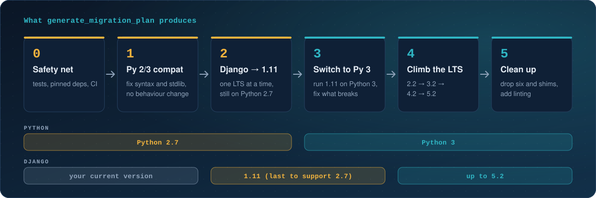

<p align="center">
  
</p>

<p align="center">
  <a href="README.md">English</a> · <b>Türkçe</b>
</p>

<p align="center">
  <a href="https://github.com/ErenOzgu/legacy-modernizer-mcp/actions/workflows/ci.yml"></a>
  <a href="LICENSE"></a>
  
  
  
  
</p>

<p align="center">
  Eski bir Python 2 / Django kod tabanının <b>ne durumda olduğunu, işin nerede yoğunlaştığını ve hangi sırayla yapılması gerektiğini</b> yapay zekâ asistanınıza söyleyen bir <a href="https://modelcontextprotocol.io">MCP</a> sunucusu.<br>
  Claude Desktop, Claude Code ve MCP destekleyen tüm istemcilerle çalışır.
</p>

---

## Hızlı başlangıç

[`uv`](https://docs.astral.sh/uv/) kuruluysa tek komutla sunucuyu Claude Code'a ekleyebilirsiniz:

```bash
claude mcp add legacy-modernizer -- \
  uvx --from git+https://github.com/ErenOzgu/legacy-modernizer-mcp \
  legacy-modernizer-mcp
```

Ardından şunu sorun:

> *legacy-modernizer ile ~/work/eski-django-uygulamam projesinin Python 3 geçişini planla.*

Claude Desktop, pip ve komut satırı kurulumları için [İngilizce README](README.md#install) sayfasına bakın.

## Neler sunuyor

| Yetenek | Ayrıntı |
|---|---|
| **Hasar haritası** | 52 kural (31 Python 2 → 3, 20 Django, 1 şablon). Her bulgu için dosya ve satır, düzeltme önerisi ve ilgili API'nin Django'dan hangi sürümde kaldırıldığı. |
| **Nereden başlanacağı** | Dosyalar ağırlıklı bulgu puanına göre sıralanır; işin çoğunu hangi dosyaların taşıdığı görülür. |
| **Sıralı plan** | Güvenlik ağından temizliğe altı faz; her LTS yükseltmesini engelleyen Django API'leri ve statik analizin göremediği noktalar için kontrol listesi. |
| **Bağımlılık kontrolü** | Sabitlenmiş Django sürümünü tespit eder; yalnızca Python 2'de çalışan paketleri (`MySQL-python`, `PIL`, `South` ...) ve sürümü sabitlenmemiş gereksinimleri işaretler. |
| **Tasarım gereği güvenli** | Kaynak dosyaları yalnızca metin olarak okur. Taradığı kodu hiçbir zaman içe aktarmaz, çalıştırmaz veya değiştirmez; sembolik bağlantıları, sanal ortamları, `.git`, `node_modules` ve 1 MB'tan büyük dosyaları atlar. |

> Bulgular **sezgiseldir**: yorumların ve metin içeriklerinin maskelendiği kaynak üzerinde düzenli ifadelerle çalışır, sözdizimi ağacı kullanmaz. Sayılar alt sınırdır; her bulguyu bağlamı içinde doğrulayın. Ayrıntı için [Sınırlamalar](#sınırlamalar) bölümüne bakın.

## Örnek

<p align="center">
  
</p>

<p align="center"><sub>Pakete dahil, kasıtlı olarak eski tutulmuş küçük bir Django 1.7 uygulaması için <code>legacy-modernizer-mcp plan tests/fixtures/legacy_project</code> çıktısının özeti. Tam plan (İngilizce): <a href="examples/sample-output.md"><code>examples/sample-output.md</code></a>.</sub></p>

Üretilen plan altı fazdan oluşur. Python ve Django ayrı adımlarda yükseltilir; ikisini aynı anda değiştirmezsiniz:

<p align="center">
  
</p>

## Araçlar

| Araç | Ne yapar |
|---|---|
| `generate_migration_plan(path)` | Tam plan: özet, en çok iş gerektiren dosyalar, sıralı fazlar, engelleyen Django API'leri, bağımlılık notları, elle kontrol listesi. **Buradan başlayın.** |
| `scan_python2_issues(path, max_findings=100)` | Python 3'te bozulan veya davranışı değişen Python 2 yapıları; kurala göre gruplanmış, dosya:satır ve düzeltme ile. |
| `scan_django_legacy(path, max_findings=100)` | Yeni Django sürümlerinde kaldırılmış API'ler; her biri kaldırıldığı sürümle etiketli. |
| `analyze_requirements(path)` | `requirements*.txt` dosyalarını okur, sorunlu paketleri işaretler, Django sürümünü tespit eder. |
| `list_rules(category="")` | Kural kataloğu (`python2`, `django`, `template`). |
| `explain_rule(rule_id)` | Bir kuralın neyi yakaladığı, neden önemli olduğu, nasıl düzeltileceği. |

Tüm araçlar `readOnlyHint=true` ile işaretlidir; istemciler onay istemeden çalıştırabilir.

Kural tablosunun tamamı için [İngilizce README](README.md#rules) sayfasına bakın.

## Nasıl çalışır

1. `scanner.py` projeyi gezer ve her dosya için kaynağın *maskelenmiş* bir kopyasını üretir: yorumlar boşaltılır, metin içerikleri aynı uzunlukta ve aynı satır sayısında dolgu ile değiştirilir. Böylece bir docstring içindeki `print "x"` bulgu sayılmaz, gerçek kullanımı sayılır.
2. `rules.py`, `Rule` nesnelerinden oluşan bildirimsel bir tablodur (kimlik, önem, açıklama, düzeltme, desen). `DJ-FK-ON-DELETE` kuralı, `ForeignKey(User, models.CASCADE)` çağrısını yanlışlıkla işaretlememek için çağrının argümanlarını okuyan küçük bir özel kontrol kullanır.
3. `requirements.py`, `plan.py` ve `report.py` bulguları bağımlılık analizine, plana ve araçların döndürdüğü Markdown çıktıya dönüştürür.

## Sınırlamalar

- **Sözdizimi çözümleyici değildir.** Veri akışı ve tür bilgisi yoktur. Alışılmadık biçimde bölünmüş veya dinamik üretilmiş yapılar kaçabilir; bazı desenler (`.keys()[0]`, `len(map(...))`) nadiren yanlış pozitif verebilir. Sayıları alt sınır olarak değerlendirin.
- **Metin/bayt hataları statik olarak görünmez.** Python 3 geçişinin en zor kısmı (örtük `str`/`bytes` dönüşümleri, G/Ç kodlamaları, pickle dosyaları) statik olarak bulunamaz; plan bunun için bir kontrol listesiyle biter.
- **Bağımlılık notları kısa, yerleşik bir listedir**; tam bir uyumluluk veritabanı değildir.
- **Yeniden yazıcı değildir.** Neyin, hangi sırayla yapılacağını söyler. Mekanik dönüşümler için `python-modernize` veya `futurize` gibi araçları kullanın ve değişiklikleri gözden geçirin.
- Yalnızca `requirements*.txt` dosyaları okunur (henüz `Pipfile`, `pyproject.toml` veya `setup.py` yok).

## Geliştirme

Kurulum, test ve yeni kural ekleme adımları [İngilizce README](README.md#development) sayfasında.

## Yazar

Eren Özgü ([@ErenOzgu](https://github.com/ErenOzgu)), Claude Code ile geliştirildi.

## Lisans

[MIT](LICENSE)
